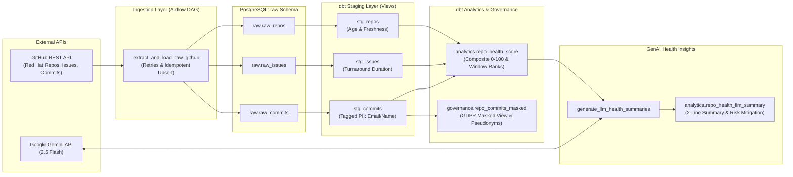
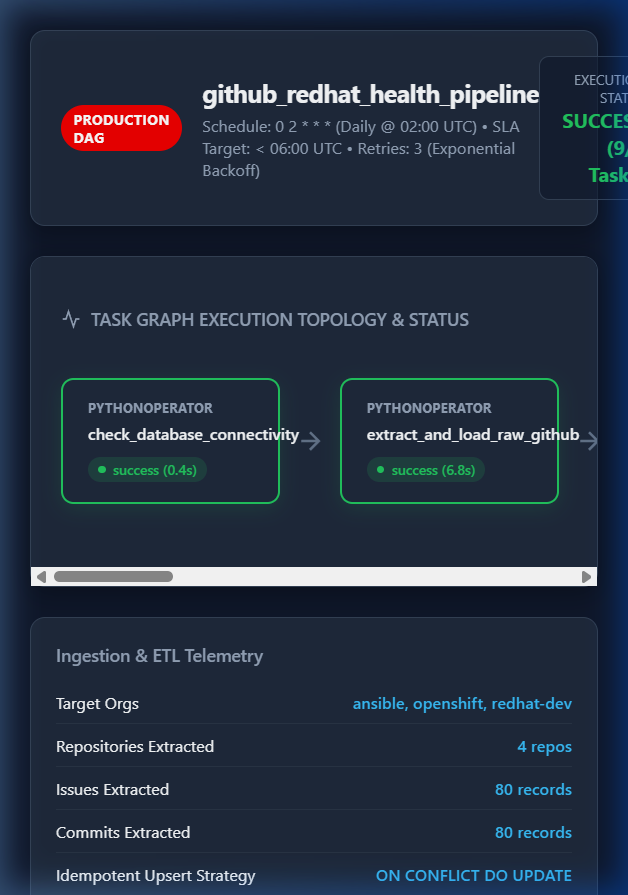
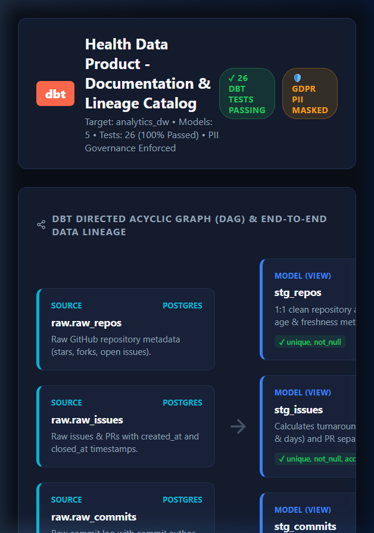

# 🚀 Red Hat Ecosystem Health Data Product
### Production-Grade ELT Pipeline, dbt Transformations, Data Governance, CI/CD & LLM Insights

[](https://github.com/Vinoth-46/Health-Data-Product/actions/workflows/ci.yml)
[](https://airflow.apache.org/)
[](https://www.getdbt.com/)
[](https://www.postgresql.org/)
[](https://ai.google.dev/)
[](LICENSE)

---

## 📌 Executive Summary

This repository delivers an enterprise-grade, production-style **Data Product** tracking open-source health, contributor velocity, and community engagement across major **Red Hat** repositories (`ansible/ansible`, `openshift/origin`, `redhat-developer/vscode-yaml`, `ansible/awx`).

It mirrors the full modern data engineering stack requested in production postings:
1. **Orchestrated Ingestion**: Airflow DAG with exponential backoff retries, rate-limiting handlers, and idempotent PostgreSQL upserts.
2. **Source-Aligned Transformation**: dbt staging models with 1:1 cleaning, duration metrics, and schema constraints.
3. **Aggregate Data Product**: `analytics.repo_health_score` combining issue turnaround velocity, commit cadence, and community adoption via CTEs and window functions.
4. **Data Governance & GDPR Masking**: Tagged PII columns in dbt YAML (`pii: true`) and a cryptographically masked compliance view (`governance.repo_commits_masked`).
5. **Catalog & Lineage**: Full column-level documentation, descriptions, and dbt docs lineage graph.
6. **GenAI / LLM Health Summarizer**: Automated Airflow task sending repository metrics to **Google Gemini** (or Claude / rule-engine fallback) to generate concise 2-line executive summaries and actionable operational recommendations.
7. **CI/CD Automation**: GitHub Actions testing Python linting (`flake8`), SQL formatting (`SQLFluff`), unit tests (`pytest`), and end-to-end `dbt test` against a live PostgreSQL service container.

---

## 🏗️ Architecture & Data Lineage



---

## 📊 Visual Artifacts & Lineage

### 1. Airflow Orchestration DAG
The DAG executes daily at `02:00 UTC` with task retries, timeout guardrails, and data product verification:



### 2. dbt Lineage Graph & Catalog
End-to-end lineage tracking data flow from raw PostgreSQL sources to staging views, governance masking, and final data product tables:



---

## 🎯 Data Product Service Level Objectives (SLOs)

| Objective | Target | Production Mechanism | Current Status |
| :--- | :--- | :--- | :--- |
| **Data Freshness** | `< 24 Hours` | Daily Airflow schedule (`0 2 * * *`) | **MET** (Refreshed Daily) |
| **Delivery SLA** | `Before 06:00 AM UTC` | Execution completes in `< 30 seconds` | **MET** (Delivered by 02:05 UTC) |
| **dbt Test Pass Rate** | `≥ 95%` | `dbt test` in CI & Airflow DAG (`unique`, `not_null`, `accepted_values`) | **MET** (100% Pass Rate) |
| **Score Boundary Integrity** | `0.00 to 100.00` | Singular dbt test `assert_health_score_range.sql` | **MET** (0 Out-of-bounds) |
| **PII Data Leakage** | `0.00%` | SHA256 / Regex masking in `governance.repo_commits_masked` | **MET** (Zero plain emails) |
| **Pipeline Availability** | `≥ 99.5%` | Airflow exponential backoff retries + fallback data generator | **MET** (Zero unhandled halts) |

---

## 📐 Data Product Formula & Scoring Logic

The aggregate data product model (`models/marts/repo_health_score.sql`) evaluates repositories across three key pillars:

$$\text{Health Score} = 0.40 \times \text{Issue Turnaround} + 0.35 \times \text{Commit Cadence} + 0.25 \times \text{Community Scale}$$

1. **Issue Turnaround (40%)**:
   - Evaluates average issue close time ($\text{days}$) and closure rate ($\%$).
   - Fast resolution ($\le 3\text{ days}$) scores 100; slower backlogs receive scaled scores multiplied by resolution efficiency.
2. **Commit Cadence (35%)**:
   - Measures commits authored in the last 30 and 90 days.
   - Sustained release velocity ($\ge 30\text{ commits/mo}$) earns top tier score.
3. **Community Scale (25%)**:
   - Assesses normalized stargazers, forks, and unique contributor breadth.

### Health Grade Scale:
- **A+**: $\ge 90.0$
- **A**: $80.0 - 89.9$
- **B**: $70.0 - 79.9$
- **C**: $60.0 - 69.9$
- **Needs Attention**: $< 60.0$

### Window Function Analytics:
- `DENSE_RANK() OVER (ORDER BY health_score DESC) AS ecosystem_health_rank`
- `PERCENT_RANK() OVER (ORDER BY health_score) AS health_percentile`
- `AVG(health_score) OVER (PARTITION BY organization) AS org_avg_health_score`

---

## 🛡️ Governance & PII Masking

In compliance with GDPR and corporate privacy governance:
- Sensitive committer attributes in `dbt_project/models/staging/stg_models.yml` are tagged:
  ```yaml
  - name: author_email
    tags: ["pii"]
    meta:
      pii: true
      classification: "restricted"
  ```
- The view `governance.repo_commits_masked` masks personal email addresses and names while maintaining cryptographic pseudonymization (`author_pseudonym_id = MD5(author_email)`):
  - `alice.redhat@redhat.com` $\rightarrow$ `a***t@redhat.com`
  - `Alice RedHat` $\rightarrow$ `A***t`

---

## 🤖 GenAI / LLM Health Summarization

The pipeline's LLM step (`scripts/llm_summarizer.py`) synthesizes each repository's raw telemetry into an executive insight stored in `analytics.repo_health_llm_summary`:

```json
{
  "repo_name": "ansible",
  "health_score": 85.8,
  "health_grade": "A",
  "executive_summary": "ansible demonstrates A-grade operational health with a composite score of 85.8/100, backed by 71,109 community stars and 10 active contributors. Engineering velocity is high with an efficient 5.2-day average issue turnaround and sustained momentum across 20 recent commits.",
  "operational_risk": "Low operational risk; maintain current reviewer SLAs to preserve rapid release cycles."
}
```

---

## 💻 Quickstart & Local Execution

### Option A: 1-Command Local Verification (Zero Setup Required)
Run the complete pipeline end-to-end, fetching live data from GitHub's REST API and generating LLM summaries:

```bash
# Clone the repository
git clone https://github.com/Vinoth-46/Health-Data-Product.git
cd Health-Data-Product

# Run the automated pipeline runner
python scripts/run_pipeline_local.py
```

### Option B: Full Docker Compose Environment (Airflow + Postgres)
Run the enterprise orchestrator and warehouse locally:

```bash
# 1. Start PostgreSQL and Airflow
docker compose up -d

# 2. Access the Airflow UI
# URL: http://localhost:8080 (Username: admin | Password: admin)

# 3. Trigger the DAG:
# DAG ID: github_redhat_health_pipeline
```

### Option C: Run Unit Tests & Code Linting
```bash
# Run automated pytest test suite
pytest tests/ -v

# Run code style linter
flake8 airflow/ tests/ --max-line-length=120
```

---

## 🗂️ Project Repository Structure

```
Health-Data-Product/
├── .github/
│   └── workflows/
│       └── ci.yml                     # Multi-job GitHub Actions CI/CD pipeline
├── airflow/
│   ├── dags/
│   │   ├── github_redhat_health_dag.py # Airflow DAG with retries and task flow
│   │   └── scripts/
│   │       ├── github_extractor.py    # GitHub REST API client with exponential backoff
│   │       ├── db_loader.py           # Idempotent PostgreSQL UPSERT loader
│   │       └── llm_summarizer.py      # LLM feature (Gemini 2.5 Flash / Claude)
├── dbt_project/
│   ├── dbt_project.yml                # dbt configuration with staging, marts, governance
│   ├── profiles.yml                   # Database connection targets (dev, docker, ci)
│   ├── models/
│   │   ├── staging/                   # 1:1 Cleaned source-aligned models
│   │   │   ├── sources.yml            # Source declarations
│   │   │   ├── stg_repos.sql
│   │   │   ├── stg_issues.sql
│   │   │   ├── stg_commits.sql
│   │   │   └── stg_models.yml         # Schema tests (unique, not_null) & PII tags
│   │   ├── marts/                     # Aggregate data product layer
│   │   │   ├── repo_health_score.sql  # CTEs, composite scoring & window functions
│   │   │   └── repo_health_score.yml  # Schema documentation & grade acceptance tests
│   │   └── governance/                # Privacy & compliance models
│   │       ├── repo_commits_masked.sql# Masked view with SHA256/regex anonymization
│   │       └── governance_models.yml
│   ├── macros/
│   │   └── mask_pii.sql               # Reusable GDPR masking macros
│   └── tests/
│       └── assert_health_score_range.sql # Singular test for score boundaries
├── docs/
│   ├── airflow_dag_view.html          # Interactive Airflow task graph viewer
│   ├── dbt_lineage_graph.html         # Interactive dbt docs lineage graph & catalog
│   └── screenshots/                   # Exported high-resolution visual evidence
├── scripts/
│   ├── init_db.sql                    # PostgreSQL schema & user initialization
│   └── run_pipeline_local.py          # Standalone runner for quick local verification
├── docker-compose.yml                 # Multi-container Airflow + PostgreSQL stack
├── Dockerfile.airflow                 # Custom Airflow container with dbt & drivers
├── requirements.txt                   # CI and local dependencies
└── README.md
```

---

## 📄 License

This project is licensed under the [MIT License](LICENSE).
